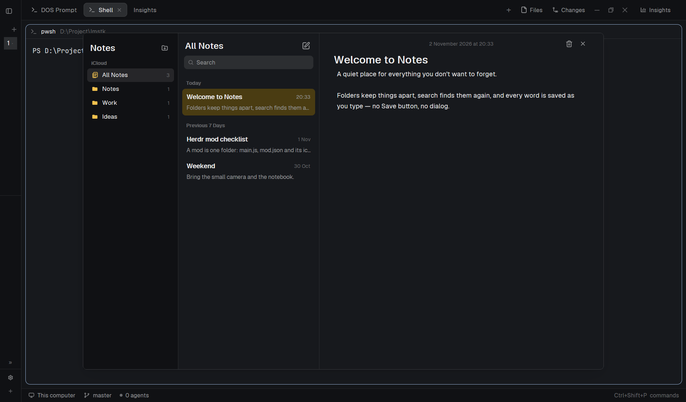

# Notes

A notes app shaped like Apple Notes: folders on the left, the notes of the chosen folder in the middle, the open note on the right. It opens as a floating window over the layout, follows the theme, and saves every keystroke to `~/.config/herdr-app/data/apple-notes/notes.json`.



## What you see

Left to right, in a 1080×700 window:

- **Folders, 196px**, `theme().chrome`. 16px top padding. A header row with "Notes" at 18px semibold and a 26×26 folder-plus button on the right. Under it, a 10.5px semibold `theme().dim` "iCloud" label. Then folder rows: 28px high, 8px side margins, 9px inner padding, 6px radius, a 14px `#f2c14e` icon, the name at 12.5px, the note count at 10.5px `theme().dim` on the right. "All Notes" comes first with a stacked-notes icon; each folder after it uses a folder icon. The selected row is `theme().selected` in a dark theme, `#dcdcd8` in a light one.
- **A 1px divider**, `theme().border`.
- **Notes list, 292px**, `theme().background`. A header row with the folder name at 18px semibold and a 26×26 compose (square-pen) button. Below it a 28px search field: `theme().raised`, 7px radius, a 12px search icon, placeholder "Search", 12px text. Then the scrolling list, grouped **Today**, **Previous 7 Days**, **Previous 30 Days**, **Older** (10.5px semibold `theme().dim` headers). Each note row is 8px in from the sides, 9px/7px padding, 7px radius: title at 13px semibold with a 10.5px date on the right, and one truncated line of body at 11.5px `theme().muted`. The date is the time for today, "1 Nov" within the same year, `dd/mm/yyyy` older. The selected row is `#f8e6a3` in light, `#4a3c12` in dark.
- **A 1px divider**.
- **Editor**, the rest, `theme().background`, 30px side padding, 8px top, 14px bottom. A 28px toolbar: the note's date centered at 10.5px `theme().dim` ("2 November 2026 at 20:33"), with trash and × buttons (26×26) at the right. The title is a 38px-high, 22px semibold input with no frame. The body is a code editor turned into a text area: 13.5px `settings().ui_font_family`, soft wrap, no line numbers, no folding, filling the rest of the column.
- **With no note open**: a 44px note icon, "No Note Selected" at 15px, a 12px hint, and a "New Note" button.

## How it behaves

- Clicking a folder filters the list to it. If the open note isn't in that folder, the first note of the folder opens; an empty folder shows the empty editor.
- Clicking a note loads its title and body into the editor.
- Typing updates the note on every change: the title and snippet in the list follow, `updated` becomes now, and the note re-sorts into Today. The file is written immediately, no Save button.
- Compose (or Cmd/Ctrl+N) adds an empty note to the current folder — from "All Notes" it goes to the first folder — and puts the cursor in the title.
- Trash deletes the open note at once (no confirmation, no trash folder) and opens the next note in the filtered list, or the empty editor.
- Search filters the current folder by title and body as you type; no matches shows "No Results".
- Folder-plus opens a 26px inline input under the folders. Enter creates the folder and selects it; Enter with an empty name just closes the row.
- Note rows and folder rows highlight with `theme().hover`; the selected note keeps its yellow row. Icon buttons get a `theme().hover` square.
- Cmd/Ctrl+F moves the keyboard to search. Cmd/Ctrl+N makes a note.
- × closes the window (`closeOverlay(props().overlay)`). A window doesn't close on Esc; `mod.open:apple-notes` toggles it from anywhere.
- The window is dragged by its chrome — the column headers and the editor toolbar. Note rows, folder rows and the text fields stop the press, so they select and type instead of moving the window.

## Built from

One mod, `mods/apple-notes/`:

```json
{ "place": "none", "title": "Notes", "overlay": { "kind": "window", "width": 1080, "height": 700 } }
```

`mod.open:apple-notes` toggles that window. `keys.json` binds it to `ctrl-shift-m`; merge, don't replace. Not `ctrl-shift-n` — Herdr ships that as `space.new`, and `cmd-*` never fires on Windows.

`main.js` exports `class AppleNotes extends View`. `init` builds three `InputState`s (title, search, new folder) and one `EditorState` for the body with `language: "txt"`, `line_numbers: false`, `folding: false`, `soft_wrap: true`, `font_family: settings().ui_font_family`, `font_size: 13.5`. `render` draws three fixed-width columns with 1px dividers; the editor takes `flex_1`.

Data lives in `data/apple-notes/notes.json` under the app home, read and written with `fs.readFile` / `fs.mkdir` / `fs.writeFile` from `fs/promises`:

```json
{ "folders": [{ "id": "notes", "name": "Notes" }],
  "notes": [{ "id": "…", "folder": "notes", "title": "", "body": "", "created": 0, "updated": 0 }] }
```

The first run seeds three folders (Notes, Work, Ideas) and three notes (Welcome to Notes, Herdr mod checklist, Weekend). A missing or unreadable file is replaced by the seed; a note whose folder disappeared moves to the first folder.

From `herdr`: `theme()`, `settings()`, `appHome()`, `props()`, `closeOverlay()`. No app commands, no `exec`, no `hc`, no network. From `gpui-kit`: `View`, `div`, `svg`. From `gpui-base`: `v_flex`, `h_flex`, `Input`, `InputState`, `Editor`, `EditorState`.

Art is eight 24×24 monochrome SVGs in the mod folder, tinted with `text_color`: `folder.svg` and `notes.svg` (both `#f2c14e`), `folder-plus.svg`, `square-pen.svg`, `search.svg`, `trash.svg`, `x.svg`, and `note.svg` for both empty states.

## In a menu

The key is not enough on its own: put a row in the sidebar footer, next to Settings, so the app is reachable by mouse. In the layout's chrome mod (`t3-chrome` here), the footer branch gains one row above Settings, and the icon is a copy of `mods/apple-notes/notes.svg` beside it:

```js
.child(row("notes", "notes", "Notes", () => run("mod.open", { name: "apple-notes" })))
.child(row("settings", "settings", "Settings", () => run("app.settings")))
```

`row` is the existing 30px row helper (icon, label, hover, `role("button")`). Two rows need the footer block's height in `layouts/<layout>.json` to go from `"px": 41` to `"px": 74` (4 + 30 + 2 + 30 + 6); leave it at 41 and the second row is clipped.

## Watch out

- **Write `mod.json` before `main.js`.** A folder seen with `main.js` and no `mod.json` gets docked into the shown layout at the right (320px); adding `"place": "none"` afterwards does not remove that copy. Delete the block from `layouts/<shown>.json` if it happened.
- **`Textarea` / `TextareaState` is a trap in this version.** It paints one line, vertically centered, even with `rows`, `set_rows` or a tall frame. Use `Editor` / `EditorState` with `language: "txt"`, `line_numbers: false`, `soft_wrap: true` for the body. The title stays an `Input`.
- **`settings().ui_font` doesn't exist.** The UI font key is `settings().ui_font_family`; `settings().font_family` is the terminal's mono font (JetBrains Mono here) and makes the body look like code.
- **`Input` and `Textarea` don't accept `on_mouse_down`.** It logs a warning and does nothing. Wrap them in a `v_flex` and stop the press on the wrapper, or pressing the text starts a window drag instead of a text selection.
- **Don't bind Cmd/Ctrl+Backspace to delete.** It was the first version and it deletes the whole note while the person is deleting a word in the editor. Delete stays on the trash button.
- Switching notes uses `set_value` on the title and body. The change handlers return early when the value equals the open note, so loading a note never bumps its `updated` time.
- The window is fixed at 1080×700, with 196 + 1 + 292 + 1 px of columns; the editor gets the rest. Narrower than about 700px the editor is cramped. The window has no title bar: × is the only close control besides the toggle key.
- Plain text only. Markdown, bold, links, images, attachments, pinning and a trash folder are not there. Deleting is immediate.
- The mod writes outside its own folder (`data/apple-notes/notes.json` under the app home). It never reads another mod's files.
- The three seed notes are examples, not a demo mode: they are normal notes and are edited or deleted like any other.

## Done when

- `herdr-app check ~/.config/herdr-app/mods/apple-notes` passes.
- `herdr-app do mod.open --name apple-notes` shows a 1080×700 window with three columns, "All Notes" selected, and "Welcome to Notes" open in the editor.
- The sidebar footer shows a Notes row above Settings, not clipped, and clicking it opens the same window.
- Typing in the title changes the list row; typing in the body changes the snippet; both survive closing and reopening the window.
- Compose creates an empty note in the current folder and focuses the title. Trash removes it and selects the next note.
- Folder-plus + Enter adds a folder with count 0; clicking it shows "No Note Selected".
- Search "weekend" leaves one row; clearing it brings the other two back.
- `herdr-app status` reports no errors.
